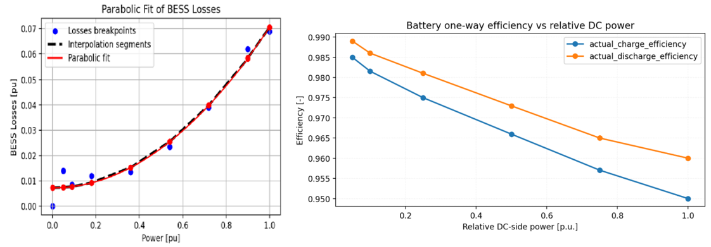
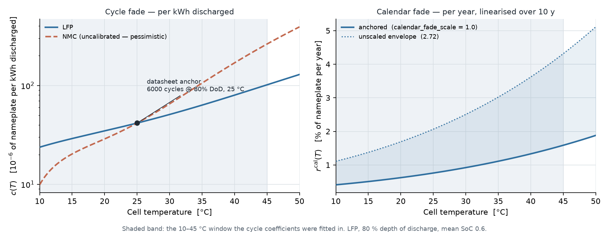

# Battery Storage

MicroGridsPy models the battery energy storage system as an aggregated electrochemical device
described through charging, discharging, and state-of-charge (SOC) dynamics. The model combines
three layers:

- **power limits**, which bound charging and discharging rates;
- **energy-balance constraints**, which govern the evolution of stored energy;
- **usable-capacity constraints**, which limit operation according to nominal or degraded
  available energy.

Two representations are supported: a **constant-efficiency** special case, and an **advanced
convex-loss formulation** where AC-side efficiency varies with power. In the **typical-year**
formulation the battery is a single block operated cyclically over a representative year; in
the **multi-year** formulation, storage investment is **cohort-based**, enabling cohort
availability and inter-year state propagation. **Battery ageing** comes in two modes: a flat
linear capacity fade available in both formulations, and a **semi-empirical** cycle-plus-calendar
model with an explicit capacity state, available in the multi-year formulation only (see
[Battery degradation](#battery-degradation)). At hourly resolution
$\Delta t = 1\,\text{h}$, so power (kW) and one-hour energy transfers (kWh) are interchangeable
in the storage balance.

## Constant-efficiency dispatch

The simplest representation uses fixed charge/discharge efficiencies $\eta_{\text{ch}},
\eta_{\text{dis}}$.

### Typical-year formulation

Charging and discharging are bounded by the installed battery **inverter (converter) power**
$P^{\text{inv}}$, an explicit sizing variable that may optionally be coupled to the installed
energy through a maximum C-rate $c^{\text{rate}}$ ($P^{\text{inv}} \le c^{\text{rate}}\,C^{\text{bat}}$):

\[
P^{\text{ch}}_{t,\omega} \le P^{\text{inv}}, \qquad
P^{\text{dis}}_{t,\omega} \le P^{\text{inv}}
\qquad \forall t,\omega
\]

The state of charge evolves as

\[
\begin{aligned}
\text{SOC}_{0,\omega} &= \text{SOC}_0\, C^{\text{bat}} \\[3pt]
\text{SOC}_{t,\omega} &= \text{SOC}_{t-1,\omega}
+ \eta_{\text{ch}} P^{\text{ch}}_{t-1,\omega}
- \frac{P^{\text{dis}}_{t-1,\omega}}{\eta_{\text{dis}}}
\qquad \forall t=1,\dots,|\mathcal{T}|-1
\end{aligned}
\]

A **cyclic boundary condition** closes the representative year:

\[
\text{SOC}_{|\mathcal{T}|-1,\omega}
+ \eta_{\text{ch}} P^{\text{ch}}_{|\mathcal{T}|-1,\omega}
- \frac{P^{\text{dis}}_{|\mathcal{T}|-1,\omega}}{\eta_{\text{dis}}}
= \text{SOC}_0\, C^{\text{bat}} \qquad \forall\omega
\]

and the SOC is bounded by the depth-of-discharge limit:

\[
(1-\text{DoD})\, C^{\text{bat}} \le \text{SOC}_{t,\omega} \le C^{\text{bat}} \qquad \forall t,\omega
\]

### Multi-year formulation

For each year $y$, scenario $\omega$, and cohort $k$, charge/discharge power is bounded by the
active installed inverter power $P^{\text{inv}}$, while the SOC is bounded by the available cohort
energy capacity $\overline{C}^{\text{bat}}_{y,k}$:

\[
P^{\text{ch}}_{t,y,\omega,k} \le P^{\text{inv}}, \qquad
P^{\text{dis}}_{t,y,\omega,k} \le P^{\text{inv}}
\]

\[
(1-\text{DoD})\,\overline{C}^{\text{bat}}_{y,k} \le \text{SOC}_{t,y,\omega,k} \le \overline{C}^{\text{bat}}_{y,k}
\]

Within each year, SOC follows the same constant-efficiency recursion, indexed by $(y,\omega,k)$.
A key difference from the typical-year case is that the multi-year model does **not** impose a
cyclic yearly boundary: the terminal state of one year is carried forward as the initial state
of the next, unless a cohort is newly installed or replaced.

## Advanced battery loss model

The advanced model replaces the constant one-way efficiencies with an explicit representation
of **power-dependent conversion losses**, recast as an LP-safe **convex piecewise-linear
epigraph**.

The public AC-side variables ($P^{\text{ch}}, P^{\text{dis}}$, and the stored energy SOC) are
complemented by internal DC-side variables: the DC power actually stored/withdrawn
($P^{\text{ch,dc}}, P^{\text{dis,dc}}$) and the conversion losses $L^{\text{ch}}, L^{\text{dis}}$.
The AC/DC balances are

\[
P^{\text{ch}} = P^{\text{ch,dc}} + L^{\text{ch}}, \qquad
P^{\text{dis}} = P^{\text{dis,dc}} - L^{\text{dis}}
\]

so when charging, the AC power drawn exceeds the energy stored, and when discharging, the AC
power delivered is lower than the internal energy withdrawn. The curve is normalized on the
installed inverter power, so both reference powers equal the inverter design variable,
$P^{\text{ref,ch}} = P^{\text{ref,dis}} = P^{\text{inv}}$, and the losses satisfy epigraph
constraints for each interpolation segment $i$:

\[
\begin{aligned}
L^{\text{ch}}_{t,\omega} &\ge m^{\text{ch}}_i\,P^{\text{ch,dc}}_{t,\omega} + q^{\text{ch}}_i\,P^{\text{ref,ch}} \\[3pt]
L^{\text{dis}}_{t,\omega} &\ge m^{\text{dis}}_i\,P^{\text{dis,dc}}_{t,\omega} + q^{\text{dis}}_i\,P^{\text{ref,dis}}
\end{aligned}
\qquad \forall i,t,\omega
\]

The coefficients $m_i, q_i$ are precomputed from the battery efficiency-curve input, keeping the
optimization **linear and tractable**. The curve is fit through the user's sampled operating
points only — it is **not** forced through the origin — so the lowest segment can carry a
positive intercept $q_i\,P^{\text{inv}}$ representing a **no-load / standby loss**. This is what
lets the model express a physically realistic **peaked** efficiency: efficiency is best near an
intermediate power and falls at both **very low power** (the fixed standby loss dominates a small
throughput) and **full power** (conversion and resistive losses grow). A curve anchored at the
origin would have $L(0)=0$ and could only ever be monotonically *more* efficient at low power,
which would make the power-dependent model uniformly cheaper than the constant baseline. The
system boundary is **AC-to-AC** (the inverter/converter plus the cell path), so the one-way
efficiencies represent the full round-trip conversion of a modern LFP + hybrid-inverter system.

Under the advanced model the SOC balance uses the DC-side flows,

\[
\text{SOC}_{t,\omega} = \text{SOC}_{t-1,\omega} + P^{\text{ch,dc}}_{t-1,\omega} - P^{\text{dis,dc}}_{t-1,\omega}
\]

so the constant-efficiency recursion is a **special case**: when the advanced model is active,
$\eta_{\text{ch}}, \eta_{\text{dis}}$ are no longer used directly and efficiency is captured
through explicit losses.

*Power-dependent battery losses and the resulting one-way efficiency. **Left:** the convex loss
curve, with a positive no-load (standby) intercept, approximated through piecewise-linear
segments. **Right:** the corresponding charge and discharge efficiency — **peaked** at an
intermediate power and lower at both very low power (standby-dominated) and full power
(conversion/resistive losses).*

## Battery degradation

Battery ageing is available in **two modes**, and only two. The first is deliberately plain; the
second is the full physical model.

| Mode | What it is | Where |
|---|---|---|
| **Linear capacity fade** (default) | a flat yearly loss of usable capacity, `capacity_degradation_rate_per_year` | both formulations |
| **Semi-empirical degradation** | cycle fade on throughput **plus** calendar fade on time, from fitted coefficients, with a usable-energy state and a hard end-of-life floor | multi-year only |

### Mode 1 — linear capacity fade

The available capacity of a cohort declines by a fixed fraction each year of its life. This is the
same exogenous term the renewable and generator technologies already carry, so battery ageing is
treated consistently with the rest of the system, and it adds **no parameters and no variables**:
it scales the availability ceiling. Set the rate to `0` to size the system without ageing at all.

Use it when you want a defensible placeholder for ageing, when you have a warranty-style capacity
guarantee to encode, or when you simply do not have a temperature series.

### Mode 2 — semi-empirical degradation

Two damage channels are carried explicitly, and they **add**:

\[
E_{y} \;=\; \underbrace{E_{y-1}}_{\text{usable energy}}
\;-\; \underbrace{F^{\text{cyc}}_{y-1}}_{\text{use}}
\;-\; \underbrace{F^{\text{cal}}_{y-1}}_{\text{time}}
\]

\[
F^{\text{cyc}}_{y} \;=\; \sum_{t} c(T_t)\, P^{\text{dis,dc}}_{t,y},
\qquad
F^{\text{cal}}_{y} \;=\; r^{\text{cal}}_{y}\, E^{\text{nom}}_{y}
\]

- $c(T)$ is the **marginal cycle-fade cost**: capacity lost per kWh of DC discharge. It multiplies
  **discharge only**, so each cycle is counted once. (A coefficient defined on charge *plus*
  discharge would be exactly half of this one — the two conventions differ by a factor of two.)
- $r^{\text{cal}}_{y}$ is the **calendar rate**: capacity lost per year as a fraction of installed
  nameplate, independent of how the battery is used.

Both are pre-fitted, exogenous coefficients — the optimisation sees constants, so it stays linear —
and both are evaluated at **cell** temperature, not outdoor air (see below).

**The end-of-life floor.** $E_y$ is the usable energy at the **start** of year $y$; the year's
fades are only subtracted when the next year begins. The floor is therefore tested on the
**end-of-year** state, in every year including the last year of the horizon:

\[
E_{y} \;-\; F^{\text{cyc}}_{y} \;-\; F^{\text{cal}}_{y} \;\ge\; \text{SoH}_{\text{eol}}\, E^{\text{nom}}_{y}
\]

A cohort is retired at its end-of-year state in its last service year, so this is the state the
end-of-life threshold refers to. An earlier version tested $E_y$ itself, which let a cohort finish
its final year one year's fade (2.5–2.8 % of nameplate on the Kalobeyei case) below the
threshold. The results report both states per cohort and year (`battery_soh_by_year.csv`) and the
lowest end-of-year value as *Battery SoH end of cohort (min)*; the dispatch column `battery_soh`
remains the start-of-year state.

This is what makes a rated lifetime *binding* rather than advisory. Note that both sides scale with
nameplate, so the floor cannot be relaxed by buying more battery; what it does instead is force
enough nameplate to carry the load *while aged*. That single constraint is the mechanism through
which ageing costs money.

**Degradation is never priced directly.** Neither fade channel appears in the objective. Ageing
costs money through exactly one channel: it shrinks the usable-energy state, the state-of-charge
window rides on that state, demand must still be met, so more nameplate must be installed — and
nameplate is what the annuities price. One channel, no double counting.

### Where the coefficients come from

**Cycle fade.** $c(T) = \Psi(\delta, T)/\delta$ is the mean slope of a depth-resolved per-cycle
fade curve $\Psi(D,T)$, distilled from an offline electro-thermal model and shipped as fine depth
slices, each a cubic in $T$. $\Psi$ is all but linear in depth — about 1.7 % from the shallowest
to the deepest slice for LFP, and flat past $D = 0.5$ — which is why **total throughput sets the
lifetime and the depth of individual cycles does not**, and why no per-depth state is carried.
Temperature is where the signal is: $c$ moves by a factor of **4.3 over 10–45 °C**.

The magnitude is pinned to the user's datasheet, so that exactly `cycle_lifetime_to_eol_cycles`
cycles at `cycle_life_reference_dod` and `cycle_life_reference_temperature_c` consume the usable
SoH budget $B = 1 - \text{SoH}_{\text{eol}}$:

\[
c(\delta_{\text{ref}}, T_{\text{ref}}) \;=\; \lambda_{\text{cyc}}\,
\frac{\Psi_{\text{raw}}(\delta_{\text{ref}}, T_{\text{ref}})}{\delta_{\text{ref}}},
\qquad
\lambda_{\text{cyc}} \;=\; \frac{B \;-\; \varphi_{\text{cal}}\,
Q_{\text{cal}}\!\left(\overline{\text{SoC}}, T_{\text{ref}}, \tau_{\text{test}}\right)}
{N_{\text{rated}}\;\Psi_{\text{raw}}(\delta_{\text{ref}}, T_{\text{ref}})}
\]

Read the reference depth and temperature **off the same datasheet line as the cycle count**:
calibrating at one depth and operating at another is a 23 % error in the fade budget.

**The rating test ages on the calendar too (Defect 11).** A datasheet cycle count is measured over
a test that lasts months to years, and the cells lose capacity to calendar ageing during it. If the
whole budget $B$ is attributed to cycling, that calendar share is counted twice in a project run —
once inside $c$, once in $F^{\text{cal}}$. `cycle_test_duration_years` ($\tau_{\text{test}}$)
removes it: the calendar fade the test itself contained, $\varphi_{\text{cal}}\,Q_{\text{cal}}$ at
the reference temperature over $\tau_{\text{test}}$ years, is subtracted from $B$ before the cycle
magnitude is fitted. Left `null` (the default) the correction is off and $c$ absorbs the whole
budget, as before.

The value is rarely printed. The reference datasheet gives 6000 cycles at 0.8 depth and 25 °C but
states neither the C-rate nor the test duration; $\tau_{\text{test}} = 2.0$ years is inferred from
the shape of its 25 °C curve, with a plausible band of **1.5–3.0 years**. For LFP at
$\varphi_{\text{cal}} = 1$ it removes $Q_{\text{cal}} \approx 0.035$ of nameplate from a budget of
0.2, so $\lambda_{\text{cyc}}$ falls from 1.229 to 1.013 (a factor 0.825) and
$c(T_{\text{ref}})$ from $4.17\times10^{-5}$ to $3.44\times10^{-5}$ per kWh discharged. A
$\tau_{\text{test}}$ whose calendar fade alone reaches $B$ is refused. Each run records
`cycle_test_duration_years`, `lambda_cyc`, `c_at_tref` and `test_time_calendar_fade`.

**Calendar fade.** An empirical storage-ageing law — Arrhenius in temperature, exponential in mean
state of charge, and $\tau^{0.48}$ in time (diffusion-limited SEI growth, so the *first* year is
much worse than the twentieth). Its **shape** comes from a published cross-study fit; its
**magnitude** is renormalised onto a direct ten-year shelf-ageing measurement, because the fit is
built on tests of a few hundred days and over-predicts when extrapolated over decades.
`calendar_fade_scale` then walks the honest literature band: **1.0 is the anchored model, 2.72
recovers the unscaled published envelope** — a spread of 2.7×. Report both ends.

Because the law is sub-linear in time but the model carries one rate per year, the rate is
linearised to reproduce the correct *cumulative* loss at the battery's service life. A consequence
worth knowing: a `%/yr` calendar rate is meaningless without stating its horizon. The same cell at
25 °C implies 0.91 %/yr over a 7-year life and 0.53 %/yr over a 20-year one.

The mean state of charge the law needs is taken as $1 - \delta/2$, the time-average of a battery
cycling over its usable window.

### Cell temperature, not ambient

Temperature series describe **outdoor air**. Cells sit inside an enclosure that runs hotter, and
the distilled cycle law already contains cell self-heating, so the correct input is the air
temperature *around the pack*:

\[
T^{\text{cell}}_t \;=\; T^{\text{amb}}_t \;+\; \Delta T_{\text{encl}}
\]

| Situation | `enclosure_temperature_rise_c` |
|---|---|
| actively cooled / air-conditioned | 0 K |
| ventilated, shaded battery room | 5–10 K |
| sealed metal container in full sun | 15–20 K |

!!! warning "This is the most influential input in the module"
    It is a design assumption, not a measurement. On an otherwise identical 25 °C site, moving
    from +0 K to +20 K cuts the derived service life from about 13 years to about 4. **Run it as
    a sensitivity and report the range**, rather than quoting a single lifetime.

*The two coefficients that cross into the optimisation, against cell temperature. **Left:** the
marginal cycle-fade cost $c(T)$, pinned so that the datasheet cycle count is delivered exactly at
the reference point (marked). **Right:** the linear-equivalent calendar rate $r^{\text{cal}}(T)$,
shown for the anchored model and for the unscaled published envelope that `calendar_fade_scale`
reaches. Shading marks the 10–45 °C window the cycle coefficients were fitted in.*

### Service life

`calendar_lifetime_years` does three jobs at once: it sets the replacement interval, it is the
amortisation period in the capital recovery factor, and it is the horizon the calendar rate is
linearised over. Nothing inside the optimisation connects it to `end_of_life_soh`, so left to
itself it can contradict the physics — retiring cells at 94 % health with two thirds of their life
unused, or asserting a life the cell cannot reach.

**Leave it `null` and it is derived**, per project, as the year at which both channels together
consume the usable budget:

\[
\varphi_{\text{cal}}\,Q_{\text{cal}}(\overline{T}^{\text{cell}}, L) \;+\; L\, f^{\text{cyc}} \;=\; B
\]

solved by bisection and **rounded to the nearest whole year, halves up** ($\lfloor L + 0.5
\rfloor$, so 8.5 becomes 9 — not Python's round-half-to-even), because the replacement schedule
steps in integers. The annual cycle fade $f^{\text{cyc}}$ is the one term that is really a dispatch
outcome, so it has to be assumed; it is estimated from the load and irradiance profiles on the
observation that an off-grid battery sized to carry the design night is discharged every night, so
cycles per year ≈ (annual dark-hour load) / (design night) — in which **the absolute sizing
cancels**, which is what makes it computable before the solve.

Setting a number instead is legitimate when it represents a *policy*: a warranty term, an O&M
contract, a financing tenor. It is then validated rather than derived.

Because $f^{\text{cyc}}$ is estimated before the solve, the derived life is a priori. The campaign
script (`scripts/run_degradation_sweep.py`) can re-derive it from the cycle fade a solve actually
realised (`refine_life`). That only carries information while the end-of-life floor is **slack**:
when it binds, the solve sizes nameplate and diesel so that the cumulative fade over $L$ years is
exactly $B$, the realised cycle fade is $(B - r^{\text{cal}}L)/L$, and re-deriving the life returns
$L$ itself — every life is a fixed point. The script therefore starts one year below the a-priori
life, steps down until the floor is slack, re-derives the life from that solve's cycling and
solves there, stopping at the first life whose floor binds. On the Kalobeyei case this gives
8.57 → 8 → 7 → 8, against 9 from the a-priori estimate. The iteration lives
outside the optimisation on purpose: the life sets the calendar rate and the amortisation, so
making it a decision variable would put products of variables in the model.

!!! tip "The consistency check worth running"
    Look at the **end-of-year** state of health in a cohort's last service year (*Battery SoH end
    of cohort* in the results). At or just above `end_of_life_soh` (0.80–0.85) the interval
    matches the physics. Far above it — 0.94, say —
    the interval is too short and healthy cells are being scrapped.

### Guards

Degenerate inputs are refused where they arise rather than producing a plausible-looking answer.

- **Sub-two-year life.** Refused outright. A one-year replacement interval would make every year a
  commissioning year, so health resets annually, fade never accumulates, and the degradation model
  **silently switches itself off** — while the capital amortises over a single year. The run would
  look optimal and be meaningless.
- **End-of-life floor infeasibility.** Over a cohort of $L$ years the floor needs
  $E^{\text{nom}}\,(B - r^{\text{cal}} L) \ge$ cumulative cycle fade. Calendar fade and the floor
  both scale with nameplate, so the model is infeasible as soon as $r^{\text{cal}} L \ge B$ —
  $r^{\text{cal}}$ is linearised over the life used, so $r^{\text{cal}} L$ is exactly the
  cumulative calendar fade at end of life. The guard tests $r^{\text{cal}} L / B$ at input time and
  names the longest admissible interval, $\lceil L^{*} \rceil - 1$ with $L^{*}$ the calendar-only
  root of the life equation. A derived life never reaches the bound; this validates a hand-set one.
- **Warning band.** Above $r^{\text{cal}} L / B = 0.70$ the run stays feasible but sizing becomes
  hypersensitive to the enclosure and calendar assumptions, so it warns.
  `calendar_fade_budget_fraction` is recorded on **every** run, so a large sweep can be sorted on
  it.
- **Fitted temperature window.** The coefficients were fitted over 10–45 °C. Outside 10–50 °C the
  cubic surrogate is untrustworthy; for NMC it turns negative below the window, which would
  silently assign *zero* cycle fade, so that case is refused rather than clipped.

### Scope, assumptions and limitations

Stated plainly, because the module is a planning-grade instrument rather than a cell model. It
does not simulate electrochemistry and does not predict absolute lifetimes to better than tens of
percent; its value is that the lifetime, the fade rates, the replacement schedule and the capital
amortisation are **mutually consistent**, derived from one set of assumptions that can be argued
with.

- **Li-ion only** (LFP and NMC). Lead-acid is out of scope: the calendar law has no lead-acid
  parameterisation and no long-duration measurement to anchor one, and lead-acid depth behaviour
  needs a different model.
- **LFP is the calibrated chemistry.** NMC inherits two known defects of the distilled
  coefficients — a temperature correction derived from an LFP datasheet applied to NMC as well
  (implied activation energy about 70 kJ/mol against a published ~50), and a cubic surrogate that
  misfits the steep NMC law by up to 14 % inside its own fitted window. **Read NMC as the
  pessimistic end of the band**; the model warns when it is selected.
- **Throughput-limited cycling.** Fade depends on total kWh discharged, not on the depth of
  individual cycles. Defensible for LFP given the fitted law; weaker for NMC. Note this
  contradicts a literature in which cycle life falls sharply with depth — though much of that
  literature counts cycles rather than throughput.
- **Additive channels.** Calendar and cycle fade add linearly. Real mechanisms couple through
  shared SEI growth; additivity is the standard engineering simplification.
- **A new battery.** Initial health is fixed at 1.0. Second-life cells are out of reach, because
  the model is linear in the state and cannot represent the fade knee below roughly 70–80 % health.
  For the same reason, **do not lower `end_of_life_soh` much below 0.8** — the threshold sits just
  before the knee, which is what makes the omission defensible.
- **Fixed mean state of charge** for calendar fade, not the realised trajectory (which would make
  the term bilinear). A PV battery sits near full charge for much of the dry season, which the
  fixed value under-represents.
- **No power fade and no efficiency fade.** Inverter power references nameplate, so an aged battery
  is weaker in energy but just as strong in power; conversion losses are constant over life. Real
  cells lose both through resistance growth.
- **Exogenous replacement schedule.** Replacement is on a fixed interval; the optimisation cannot
  choose to replace early, which would need integer timing.
- **Non-cell failures are not modelled at all** — BMS faults, inverter failures, installation
  quality, over-discharge, dust, lightning. In field experience these frequently set replacement
  timing more than chemistry does.
- **Calendar magnitude is uncertain by 2.7×**, which is the honest spread between the cross-study
  fit and the one long-duration measurement available.

### Configuration & inputs

Mode 1 needs one input, which every technology already has:

| Input | Where | Notes |
|---|---|---|
| `capacity_degradation_rate_per_year` | `battery.technical` | fraction/yr; `0` disables ageing |

Mode 2 is selected with `battery_model.degradation_model.coefficients_enabled` and requires the
**multi-year** formulation and the **convex-loss** efficiency model — throughput is defined on the
internal DC-side powers, so a constant round-trip efficiency leaves nothing for $c(T)$ to
multiply. It takes eight inputs, five of which have usable defaults
(`cycle_test_duration_years` sits in `formulation.json` under `battery_model.degradation_model`
and is deliberately kept out of the GUI setup form):

| Input | Default | Notes |
|---|---|---|
| `chemistry` | — | `LFP` or `NMC` |
| `cycle_lifetime_to_eol_cycles` | — | datasheet cycle count |
| `end_of_life_soh` | — | the health that count refers to, and the floor |
| `cycle_life_reference_dod` | 0.8 | the depth the count was measured at |
| `cycle_life_reference_temperature_c` | 25 | and the temperature |
| `enclosure_temperature_rise_c` | 10 | outdoor air → enclosure air |
| `calendar_fade_scale` | 1.0 | 1.0 anchored · 2.72 unscaled envelope |
| `cycle_test_duration_years` | `null` | duration of the datasheet cycle test, years in (0, 20]; `null` = no test-time calendar correction |

It also needs `inputs/ambient_temperature.csv` — the key per-project degradation input, since both
channels are evaluated against it. `capacity_degradation_rate_per_year` is **ignored** in this
mode (and says so), because calendar ageing is modelled explicitly and applying a flat rate as
well would remove the same capacity twice.

Every run records its resolved assumptions under
`settings.battery_model.degradation_model` — the derived and used service life, the assumed cycles
per year, the mean cell temperature, the calendar budget fraction, $\tau_{\text{test}}$,
$\lambda_{\text{cyc}}$, $c(T_{\text{ref}})$ and the test-time calendar fade — so a result can be
audited without re-deriving it. The Results page shows them under *Battery degradation
traceability*.

!!! info "Not currently modelled"
    **Endogenous replacement timing.** Optimal size and replacement date are coupled: a larger
    bank cycles more shallowly and lasts longer. Jointly optimising them is mixed-integer-hard, so
    the interval is derived beforehand and held fixed. Sweeping it around its derived value, with
    each inner solve kept linear, is the cheap way to probe the coupling.

    **The fade knee.** Capturing the acceleration below ~70–80 % health needs state-dependent
    coefficients, which is bilinear and needs binaries over a state-of-health axis.

### References

Cycle-fade shape $\Psi(D,T)$ is distilled from an offline electro-thermal + semi-empirical ageing
model, which computes the depth curve directly; the distilled coefficient file ships with the
package and carries its own provenance block. That model is archived separately; see the project's
data archive for the DOI. <!-- TODO: insert Zenodo DOI once published. -->

The calendar-fade shape follows M. U. Ali et al., *Assessment of the calendar aging of lithium-ion
batteries for a long-term space mission*, **Frontiers in Energy Research** 11:1108269 (2023),
Table 3. Its magnitude is anchored to the ten-year LFP/C shelf-ageing measurement of *Shelf life of
lithium-ion batteries: recommissioning LiFePO₄/C cells after ten years of uninterrupted calendar
aging*, **Journal of Power Sources** (2025), which found 96–98 % capacity retention after ten years
at 6 °C and 50 % state of charge. The state-of-charge sensitivity is cross-checked against
M. Naumann et al., *Analysis and modeling of calendar aging of a commercial LiFePO₄/graphite cell*,
**Journal of Energy Storage** (2018).

The linear-recursion decomposition that the two-channel structure follows is due to S. Andrade,
*Battery Degradation Modelling for Off-Grid Energy System Sizing: Methodology and Case Study in the
African Context* (MSc dissertation, Politecnico di Milano / FCUL, 2023). The coefficients, their
units, their calibration anchors and the aggregation to a yearly calendar rate differ from that
work; the structure does not.
